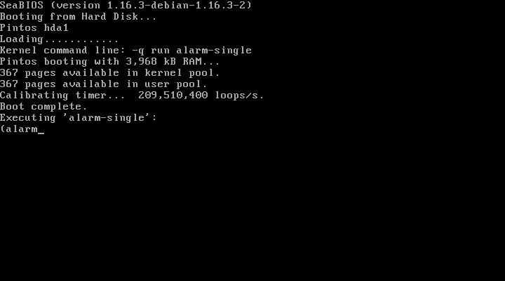
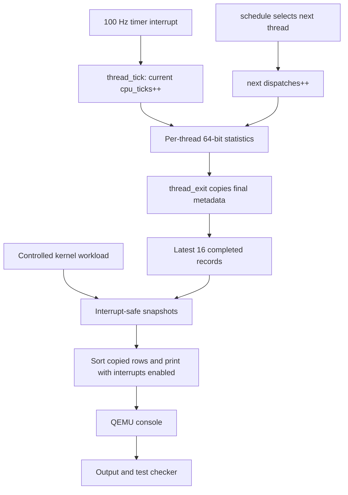
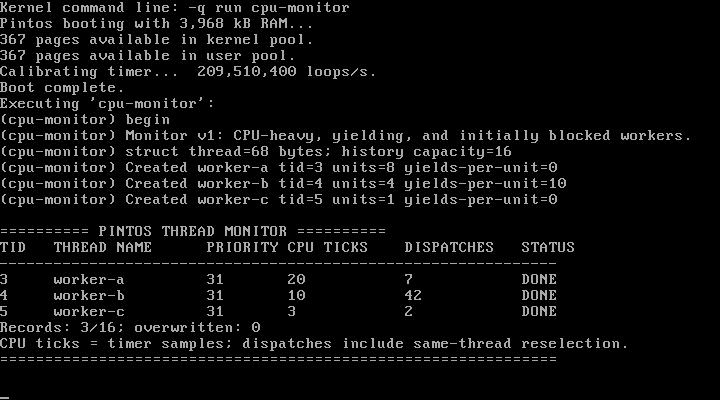

# Pintos Kernel — Per-Thread CPU Monitoring and Scheduling Analytics

## 1. Title page

| Item | Details to complete before submission |
| --- | --- |
| Course | [Course name] |
| University | [University name] |
| Team member 1 | [Name] |
| Register number 1 | [Register number] |
| Team member 2 | [Name] |
| Register number 2 | [Register number] |
| Faculty | [Faculty name] |
| Submission date | [Submission date] |

Report draft based on actual implementation and verification through
22 October 2026. Personal and institutional details have not been invented.

## 2. Abstract

This project extends the JHU distribution of Pintos with per-thread CPU
sampling and scheduling analytics. The kernel records timer ticks and
scheduler dispatches for each thread, copies statistics before a completed
thread is destroyed, and retains the latest 16 completed records. A controlled
kernel workload reports genuine results through QEMU. Interrupt-safe snapshots
protect 64-bit counters on the 32-bit target, while reporting occurs in ordinary
thread context. The original kernel was first built and booted, and its
artifacts and evidence were preserved. Final tests passed the monitoring
workload, bounded-history checks, and selected existing timer/scheduling tests.
A priority-fifo failure was reproduced unchanged on the original kernel and
is documented as an upstream limitation. Source-only isolated verification
also demonstrated reproduction without the developer's archived binaries.

## 3. Introduction

A small educational operating system makes interactions among interrupts,
threads, and scheduling visible without the scale of a production kernel.
A scheduler chooses which ready thread runs, but understanding those decisions
also requires observations: which thread received CPU samples, how often it
was selected, and what happened after it completed. Aggregate totals answer
system-wide questions but do not identify individual workloads.

The assignment required a lightweight OS other than xv6, a demonstrated
original build, genuine kernel modifications, verified execution, a report,
and balanced participation in a two-person video. The project therefore
focuses on instrumentation of existing thread-management paths rather than
introducing another scheduling policy.

## 4. Operating-system selection and scope

Pintos is an educational x86 OS originally developed at Stanford; this project
uses the JHU CS318 distribution and preserves its attribution and license [1].
Its implementation is mostly C with assembly for low-level boot and switching.
The small thread structure, accessible scheduler, and built-in tests make it
suitable for a narrowly scoped instrumentation project. The official reference
guide explains the thread page/stack layout and the scheduler/timer interfaces [2].

The team did not create Pintos. Its contribution is per-thread monitoring,
completed-history retention, report APIs, controlled tests, and reproducible
presentation tooling. The scheduling policy, priority values, timer frequency,
context-switch assembly, networking, and process-management features remain
outside the change. A graphical interface and instruction-level profiler were
also outside scope.

## 5. Problem statement

Inspection of the original source at
`ab699959f0d3eae8e59d8507ae2474a638c3d1d3` establishes the gap. Its
`thread.c` has global `idle_ticks`, `kernel_ticks`, and `user_ticks` counters.
The existing `thread_ticks` measures only the current time slice and resets
when a thread is scheduled. Its `struct thread` has no lifetime CPU-sample or
dispatch fields. `thread_exit()` removes a thread and the scheduler later frees
its page; the global shutdown statistics cannot preserve an individual
completed thread's history. Nice/recent-CPU interfaces are unimplemented stubs
in this distribution, rather than an existing implementation of our feature.
These findings are based on the actual baseline source, not assumptions about
other Pintos variants.

## 6. Objectives

The four implemented objectives were:

1. Count CPU timer samples independently for each thread.
2. Count every scheduler selection of a thread, with a precise dispatch definition.
3. Preserve copied statistics for completed threads within fixed storage.
4. Generate a readable kernel-side report from safe snapshots.

A three-worker workload and a separate history-capacity test demonstrate these
properties. Success must come from real kernel execution and checkers, without
hardcoded addresses, counter values, or fabricated output.

## 7. Development environment

| Component | Verified environment |
| --- | --- |
| Host interface | Windows with Ubuntu 24.04.1 under WSL2, x86_64 |
| Compiler | GCC 13.3.0; 32-bit x86 kernel output |
| Build tools | GNU Make 4.3, binutils 2.42 |
| Emulator | qemu-system-i386 8.2.2, headless software emulation |
| Supporting tools | Perl 5.38.2, Python 3.12.3, Git 2.43.0 |

WSL installation and environment separation follow Microsoft's instructions [3].
The source lives on the Linux filesystem. The portable setup checks tools and
32-bit object generation without silently installing packages or invoking sudo.
Its Ubuntu prerequisites are Git, build-essential, binutils, gcc-multilib, Perl,
Python 3, and qemu-system-x86. No additional Python library is required.

The original default build compiled, but repeatedly reset during boot. GCC's
position-independent defaults were visible in the generated objects. Rebuilding
with `-fno-pie -fno-pic` resolved the failure without a source patch. GCC documents
these code-generation options and their negative forms [4]. The working flags
also retain `-m32 -g -msoft-float -O0 -fno-stack-protector`. A force rebuild avoids
mixing objects compiled with different flags.

## 8. Original-kernel baseline

The `baseline-unmodified` tag identifies the original revision above. The
original build and the failed default boot were retained, followed by the
successful compatibility build and genuine boot log. The generated kernel was
verified as a statically linked ELF32 Intel 80386 executable; its loader is a
512-byte boot sector.

The successful boot initialized Pintos, printed `Boot complete.`, executed
`alarm-single`, reported five ordered wakeup products 10/20/30/40/50, and
printed `Powering off...`. The original Perl checker returned PASS. The supplied
launcher recognizes raw QEMU status 99 as normal `isa-debug-exit` shutdown;
the checks additionally require the completion messages. A forced timeout is
never treated as successful evidence.

`evidence/baseline/` preserves complete logs, revision/environment records,
checksums, original binaries, and the standalone baseline disk. The final
baseline demonstration executes that disk live while explicitly labeling
archived build material. Finalization preserved the files byte-for-byte.



Figure 1. Original QEMU framebuffer captured after successful initialization.
This historical image is evidence; the demonstration separately executes live.

## 9. System architecture



The timer already invokes `thread_tick()`, so no redundant interrupt handler is
needed. Dispatch accounting observes selection without changing the selected
thread. Exit accounting copies data before the existing destruction path.
The host runner only boots and validates the guest output; it does not calculate
the kernel's CPU or dispatch values.

## 10. Kernel modifications

### 10.1 Per-thread fields and initialization

The two fields are stored before the existing stack-overflow sentinel:

```c
uint64_t cpu_ticks;
uint64_t dispatches;
unsigned magic;
```

`init_thread()` explicitly initializes both counters to zero before a new
thread becomes runnable. The bootstrapped main thread receives one initial
dispatch because it begins execution before `schedule()` first selects it.
The threads-only structure grew from 52 to 68 bytes, safely below the enforced
1 KB limit within its shared 4 KB structure/stack page. Large test arrays use
static storage; reporting avoids a large local array.

### 10.2 CPU accounting

The existing accounting function obtains the current thread and adds:

```c
struct thread *t = thread_current ();
t->cpu_ticks++;
```

The original global idle/kernel/user accounting and four-tick preemption remain.
The idle thread follows the same per-thread sample rule, but normally does not
complete and is absent from the completed-only table. At 100 Hz, each sample
represents a timer observation approximately 10 ms apart. It is not a direct
measurement of exact wall-clock CPU time or instructions.

### 10.3 Dispatch accounting

The new increment occurs after selecting and validating the next thread:

```c
next->dispatches++;
if (cur != next)
  prev = switch_threads (cur, next);
```

A dispatch is each scheduler selection, including selecting the same thread
again. It therefore differs from an actual switch between two threads, a
creation, a timer interrupt, or a voluntary yield. A yield can cause another
selection even when no other worker remains ready.

### 10.4 Completed-thread history

`thread_exit()` inserts one call into the original interrupt-disabled exit path:

```c
intr_disable ();
monitor_complete (thread_current ());
list_remove (&thread_current()->allelem);
thread_current ()->status = THREAD_DYING;
schedule ();
```

`monitor_complete()` copies the TID, bounded name, priority, 64-bit counters,
and completed status into a 16-entry circular array. It advances the slot and
increments an overwrite count when replacing the oldest record. Each record
is 44 bytes, giving 704 bytes of fixed history storage. No pointer into the
thread page survives; no allocation, printing, or blocking is added to this
critical path. The original scheduler tail still frees a dying thread's page.

### 10.5 Snapshots and reporting

On 32-bit x86, a 64-bit value can require multiple memory accesses.
`thread_monitor_current()` and `thread_monitor_snapshot()` briefly disable
interrupts while copying fields, then restore the prior interrupt state.
The history snapshot returns the newest records fitting the caller's capacity;
a zero-capacity query is valid. All storage is bounded.

`thread_monitor_report()` is called only from ordinary thread context with
interrupts enabled. It requests at most 704 bytes for copied records, takes a
snapshot, sorts those copies by TID, prints, and frees the buffer. Allocation
failure is returned to the caller and fails the controlled test. No console
output occurs inside the timer or scheduler instrumentation.

Only `thread.h` and `thread.c` change kernel behavior. Test registration edits
are confined to `tests/threads/tests.c`, `tests.h`, and `Make.tests`; the new
workload/checkers are `cpu-monitor.c`, `cpu-monitor.ck`, and `monitor-overflow.ck`.
Finalization adds no new kernel feature and preserves these source files.

## 11. Testing methodology

The CPU-monitor test creates worker-a, worker-b, and worker-c at priority 31.
Their calibrated busy-work units are 8, 4, and 1 units of 25 ms. Worker-b also
yields ten times per unit. All initially wait on semaphore gates while the
controller runs. Interrupt-controlled before/after snapshots verify that a
blocked worker receives no samples while it cannot execute.

Workers verify initialized IDs/dispatches and monotonic counters. The controller
checks unique IDs, matching copied names and priorities, completed status,
nondecreasing final values, and exactly one final record per created worker.
It waits for the actual exit record, because a completion semaphore can be
signalled before `thread_exit()` runs. No assertion requires fixed tick totals
or a fixed ratio between workers.

The overflow test creates 19 short-lived threads. It checks retention of the
newest 16, exactly three overwrites, unique retained IDs, and one-entry and
zero-capacity snapshots. Existing alarm-single, alarm-simultaneous, and alarm-zero
tests provide selected timer and scheduling regressions. All use Pintos checkers.
Priority-fifo is compared against both original and modified kernels, including
its known failure, rather than being silently excluded from the report.

For portability, an isolated source-only export contained the committed Phase 2
sources plus the new setup/demo helpers, but no evidence, previous build, or
archived kernel. It built and ran the supported suite from a directory with
spaces and with a different caller working directory. Setup reruns were tested.
This is same-host isolated-source verification, not a second-laptop result or
a final fresh-clone result; the Phase 3 files still require manual publication.

## 12. Results

Latest finalization live run, copied from the actual guest report:

```text
TID   THREAD NAME      PRIORITY CPU TICKS    DISPATCHES   STATUS
3     worker-a         31       22           7            DONE
4     worker-b         31       10           42           DONE
5     worker-c         31       3            2            DONE
Records: 3/16; overwritten: 0
```

Worker-b's frequent selections explain its higher dispatch count despite fewer
CPU samples than worker-a in this run. DONE rows remain available after the
workers' thread pages have been destroyed. Other genuine runs produced 21/9/3
and 20/10/3 sampled ticks. These variations are expected; none is hardcoded.

| Final check | Result |
| --- | --- |
| Original baseline demo, default and video modes | PASS |
| Modified source build, image validation, and smoke test | PASS |
| CPU monitor and completed-history overflow | PASS |
| alarm-single, alarm-simultaneous, alarm-zero | PASS |
| Isolated source-only setup/demo/rerun | PASS on the existing WSL host |
| priority-fifo, original kernel | FAIL: No iterations found in output. |
| priority-fifo, modified kernel | Identical FAIL: No iterations found in output. |
| Person 2's physical laptop | Not tested by the authoring agent |

Priority scheduling is unfinished in this supplied distribution; merely storing
priority numbers does not implement it. The identical priority-fifo failures
are not claimed as passes or as a newly fixed feature. The supported regression
suite passed; the whole Pintos assignment suite was not certified.



Figure 2. Actual QEMU framebuffer from a prior verified run showing 20/10/3
samples. It is a historical screenshot, distinct from the latest table above.
The guest resumed after capture and completed normally.

## 13. Challenges and solutions

Compiler compatibility required explicit non-PIE flags after the default kernel
reset during startup. Preserving the failed log prevented compilation success
from being confused with a successful boot. Thread lifetime was addressed by
copying records before removal/freeing. Multiword snapshots were addressed by
brief interrupt exclusion, with sorting and output deferred to safe context.
Bounded history made memory use predictable and exposed overwrites explicitly.

The initial modified demo depended on local archives absent from a clone.
Finalization separated preparation from recording: setup compiles current source
and creates local artifacts; the demo only executes them and their checkers.
A shared runner reuses the QEMU/checker logic, verifies hashes and source state,
and records real status/output. No manual binary transfer is necessary.

The first debugger screenshot attempt miscounted source lines because Python's
splitlines also treats form feeds as separators. Using newline-based numbering
fixed capture without changing kernel code. This affected only evidence capture.
The unrelated priority-fifo failure was checked on the original kernel and
reported accurately instead of prompting a scheduling-policy change.

## 14. Limitations

The monitor samples at the existing timer frequency; short jobs can receive zero
samples and interrupt overhead can be attributed to the interrupted thread.
It reports only completed threads, retains 16 records, truncates names to the
existing field size, and resets each boot. Interrupt exclusion assumes a single
CPU; no SMP correctness is claimed. Added counter/copy operations have overhead,
but this project does not claim a measured overhead percentage. Extremely long
runs assume 64-bit counters do not wrap. Priority/MLFQS implementation remains
outside scope. Cross-laptop portability still requires actual execution on the
second laptop after Phase 3 publication.

## 15. Conclusion

The project adds observable per-thread behavior to an existing educational
kernel without replacing its scheduler. Timer samples, scheduler selections,
and copied completion history answer different questions and can be checked
independently. Tests show normal boot/shutdown, retained results, bounded storage,
and preserved selected scheduling behavior. Source-only reproduction and honest
baseline comparison strengthen the demonstration beyond a single successful
build or an unexplained console table.

## 16. References

1. [JHU CS318 Pintos source repository](https://github.com/jhu-cs318/pintos),
   baseline revision `ab699959f0d3eae8e59d8507ae2474a638c3d1d3`; original README
   and `src/LICENSE` for Stanford/JHU attribution. Source was inspected locally.
2. [Stanford Pintos reference guide](https://www.scs.stanford.edu/10wi-cs140/pintos/pintos_6.html),
   particularly thread structures, switching, and interrupt handling.
3. [Microsoft: Install WSL](https://learn.microsoft.com/en-us/windows/wsl/install).
4. [GNU GCC: Code generation options](https://gcc.gnu.org/onlinedocs/gcc/Code-Gen-Options.html),
   position-independent code options and negative forms.
5. [Project repository](https://github.com/hst257/Pintos-Kernel-Monitor), Phase 2
   commit `476d3e1`; project-specific kernel/tests and actual local evidence.

References checked on 22 October 2026. General reference documentation describes
Pintos concepts; claims about this implementation and results use the pinned
source and collected evidence.

## 17. Appendix: reproducibility and submission assets

Before recording, inside Ubuntu:

```bash
git clone https://github.com/hst257/Pintos-Kernel-Monitor.git
cd Pintos-Kernel-Monitor
bash setup_person2.sh
bash demo_person2.sh
```

The author must first commit/push Phase 3. Person 1's original preserved checkout:

```bash
bash demo_baseline.sh --video
bash demo_modified.sh
```

Use `bash demo_person2.sh --full` for full console output, or consult the printed
`generated/person2/demo-runs/live-*` location for raw outputs/checker results.
`docs/FINAL_TESTING_SUMMARY.md` maps final tests to evidence;
`docs/PORTABILITY_VERIFICATION.md` records isolation details and remaining gaps.
Baseline and Phase 2 evidence remain locally preserved. Screenshots embedded in
this report are small genuine copies in `docs/images/`; do not replace them with
reconstructed or illustrative output. Fill in the title-page fields, verify the
second laptop, and attach any required report export before submission.
